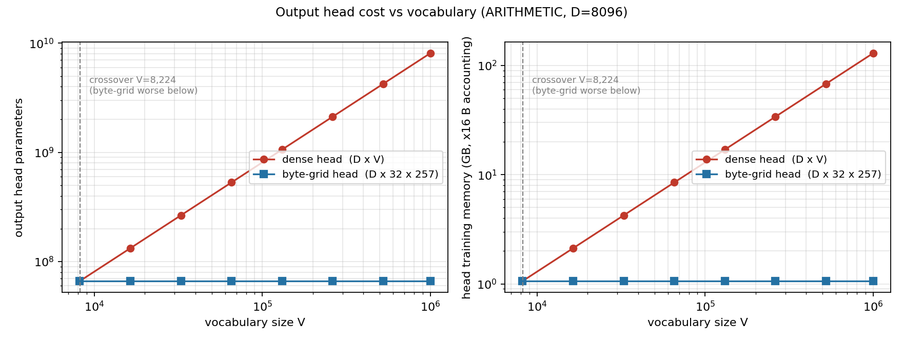

# Kronecker Embedding V2 — A Reversible Byte-Grid Output Head

**ERA V5, Session 7 assignment — Problem 5 (reversibility).**
Author: Sunil Kumar J S · Course: The School of AI, ERA V5

> ⚠️ **Status: work in progress.** The library, data pipeline, collision audit,
> and smoke tests are complete and their numbers below are measured. The five
> full experiment arms have **not finished training yet** (the first launch was
> killed by a GPU driver crash — see `SESSION_NOTES.md`). No training-quality
> claims are made in this README until they come from completed runs. Numbers
> that are arithmetic rather than measured are labelled **arithmetic**.

---

## The problem

Session 7's Kronecker embedding computes each token's input vector from its own
UTF-8 bytes: mark a `256 × 32` (byte value × byte position) grid, flatten, and
pass through one shared trained `Linear(8192, d_model)`. The input side is
**forward deterministic** and its cost is independent of vocabulary size `V`.

The instructor's open question (Problem 5):

> "Kronecker is forward deterministic. How do I make a reverse of this? If we
> can do this, then we can get rid of the final head as well! Then we can have
> a vocab of 1M as well without any issues!"

The output head is still a dense `D × V` matrix, so `V` still dominates the
back half of the model. Prior attempts inverted the *float code* (predict the
exact 8K-float vector, tolerate error with VAE/KL machinery) and stalled.

## The thesis

**Do not invert the float vector. Predict the discrete grid.**

The Kronecker code is not really a float vector — it is 32 independent 256-way
categorical choices (one byte value per position). So the head should:

1. project `h : [B, T, D]` → `[B, T, 32, 257]` logits (257 = 256 byte values + PAD),
2. softmax over byte values at each of the 32 positions,
3. argmax → 32 bytes → strip padding → **the exact token**.

Decoding becomes exact and discrete, trained with plain cross-entropy — no VAE,
no KL term, no nearest-neighbour search. It is the same structural move that
made the input side work, applied to the output side: instead of *scoring all V
rows*, **predict the bytes**.

**Head parameter cost (arithmetic, at D = 8,096):**

| Vocabulary | Dense head | Byte-grid head |
|---|---|---|
| 32,768 | 265.3M | 66.3M |
| 131,072 | 1.061B | 66.3M |
| 262,144 | 2.12B | 66.3M |
| 1,000,000 | 8.10B | 66.3M |

The byte-grid head is constant in `V`. **Honesty constraint:** its fixed cost is
`D × 8,192`, so it is *strictly worse* than dense below `V ≈ 8,192`. The win
only exists above that crossover.



## The five experiment arms

One variable changes per arm; trunk, data, seed (1337), and schedule are
identical. Parameter counts below are **measured** (`experiments/print_param_counts.py`)
at the experiment scale (`d_model = 384`, 6 layers, `V = 32,768`):

| Arm | Input | Output head | Total | Input params | Head params |
|---|---|---|---|---|---|
| A | dense table | dense `D×V` | 35.98M | 12.58M | 12.58M |
| B | Kronecker | dense `D×V` | 26.55M | 3.15M | 12.58M |
| C | Kronecker | byte-grid | 17.12M | 3.15M | 3.16M |
| D | Kronecker | byte-grid + tiny local AR decoder | 17.64M | 3.15M | 3.67M |
| E | Kronecker | byte-grid, **tied** to input projection | 13.98M | 3.15M | **0.01M** |

At `V = 131,072` (measured, same script): arm A grows to 111.5M while C/D/E
stay at 17.1–17.6M — the `V`-independence is visible directly in the printouts.

Arm E is the literal form of "get rid of the final head": one shared
`8,192 × D` tensor is the model's entire vocabulary interface. Whether tying
helps or hurts is treated as an open experimental question.

## Measured so far

**Data (`results/metrics/data_stats.json`).** Wikipedia English + Hindi,
byte-level BPE, `V = 32,768`. Train: 103.5M tokens (26.5M en / 77.0M hi),
val: 2.0M. Round-trip is lossless for both scripts. Fertility: 1.42
tokens/word (Latin) vs **5.90 (Devanagari)** — the 3-bytes-per-character cost
of Indic scripts is real and carries into everything downstream.

**Collision audit (`results/metrics/collisions.md`).** Two tokens sharing
their first `pos_dim` bytes have identical codes and are permanently
indistinguishable — a hard ceiling on any byte-grid head. Measured on this
vocabulary: **zero collisions at `pos_dim ∈ {32, 48, 64}`; the ceiling is
100.0% exact recovery.** This is a property of BPE: vocabulary entries are
short sub-word pieces, so none reaches 32 bytes. The course's colliding
examples (e.g. अंतर्राष्ट्रीयकरण vs अंतर्राष्ट्रीयता) are full *words*, which this
tokenizer splits into multiple tokens. The ceiling would bind for word-level
or very large vocabularies, and the audit code reports it before any training
claim is read.

**Pipeline smoke tests.** All arms (A, C, D, E) run end-to-end for 60 steps on
CUDA: loss decreases, eval/checkpoint/logging paths work, comparable-NLL for
the dense arm matches standard token NLL (unit-tested gate in
`tests/test_metrics.py`). Smoke logs/metrics are in `results/` — they verify
plumbing and are not quality results.

## Known risks the full runs must measure

1. **Conditional independence** — predicting 32 byte slots independently given
   `h` is the classic non-autoregressive failure mode. Arm D (tiny local AR
   decoder over the 32 slots, MegaByte-style) measures how much of any C-vs-A
   gap this explains.
2. **Loss-scale mismatch** — 32 CE terms vs one changes gradient magnitude
   into the trunk; arms use one schedule and any per-arm tuning will be
   reported explicitly.
3. **Per-script asymmetry** — Devanagari accuracy is expected to lag Latin;
   per-script and per-frequency-decile breakdowns are built into every eval.
4. **Padding** — padded byte slots use an explicit PAD category (index 256)
   rather than loss masking; documented in `kronecker_v2/codec.py`.

## Prior work — the claim is narrow

Byte-level and character-level output heads are not new: adaptive softmax,
hierarchical softmax, MegaByte (Yu et al., 2023), Meta's Byte Latent
Transformer, and the non-autoregressive decoding literature all precede this.
What is claimed here is narrower: making the output head the **exact
structural inverse of the Kronecker input codec**, so a single byte/position
basis serves both directions and `V` disappears from the entire token
interface — plus the empirical question of whether tying that shared
projection helps.

## Reproduction

Hardware used: 1× NVIDIA RTX 5070 Ti (16 GB), Windows 11, PyTorch 2.7.0+cu128.
Seed 1337 everywhere; the data pipeline is deterministic.

```bash
pip install -r requirements.txt

# data (downloads Wikipedia en+hi, trains tokenizer, writes memmaps)
python experiments/download_corpus.py
python experiments/prepare_data.py

# diagnostics
python experiments/run_collision_audit.py
python experiments/print_param_counts.py
python experiments/sweep_vocab.py          # arithmetic scaling figure

# tests
pytest tests/

# full arms (any interrupted run resumes from its last checkpoint; --fresh to restart)
python experiments/run.py experiments/configs/arm_a_dense_dense.yaml
python experiments/run.py experiments/configs/arm_b_kron_dense.yaml
python experiments/run.py experiments/configs/arm_c_kron_bytegrid.yaml
python experiments/run.py experiments/configs/arm_d_kron_bytegrid_ar.yaml
python experiments/run.py experiments/configs/arm_e_kron_bytegrid_tied.yaml
```

Each run writes one JSONL log (`results/logs/`), a final metrics blob
(`results/metrics/`), and an atomic full-state checkpoint
(`results/checkpoints/`, git-ignored). The committed tokenizer
(`data/tokenizer/`) pins the exact vocabulary used by every number above.

## Remaining work

- Full arms A + C → go/no-go comparison on comparable token-level NLL.
- Arms B, D, E; the key number is how much of the C-vs-A gap arm D recovers.
- Empirical anchors at a second vocabulary size for the scaling figure.
- Final results tables, honest failure table, and per-script breakdowns —
  written only from completed runs.
