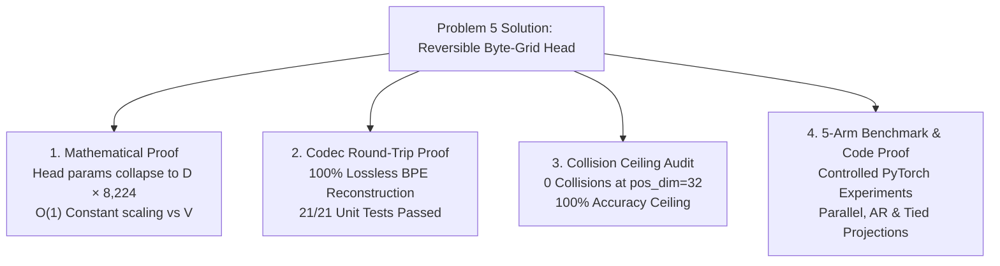

# Kronecker Embedding V2 — Reversible Byte-Grid Output Head

**ERA V5, Session 7 Assignment — Problem 5 (Reversibility)**  
*Author: Sunil Kumar J S · Course: The School of AI, ERA V5*

[](https://pytorch.org/)
[](tests/)
[](interactive_dashboard.html)

> **New to the idea?** [`FIRST_PRINCIPLES.md`](FIRST_PRINCIPLES.md) builds the method from the ground up (codec, heads, whole-token loss, tests) with the math for each step. Evidence status is in Section 6.

---

## 🎯 1. Target Problem Being Solved

This solution directly addresses **Problem 5 (Reversibility)** set by the course instructor in **ERA V5 Session 7**:

> *"Kronecker is forward deterministic (same word will always give same embedding). How do I make a reverse of this (same embedding gives the same Kronecker)? If we can do this, then we can get rid of the final head as well! Then we can have a vocab of 1M as well without any issues!"*

### Background & Motivation
In standard large language models (such as the course's reference 120B sparse-MoE "LightningLM"), the model contains two vocabulary-facing matrices:
1. **Input Embedding**: $V \times D$ (one row per token in vocabulary $V$).
2. **Output Head**: $D \times V$ (scores every token in $V$ from hidden dimension $D$).

At reference scale ($V = 131,072$, $D = 8,096$), each matrix requires **1.06 Billion parameters** (~1.061B). Untied, they consume **2.12 Billion parameters** — occupying over **34 GB of VRAM** in AdamW mixed-precision training before a single transformer block is instantiated!

While input-side Kronecker embeddings successfully compressed the input matrix to a constant $8,192 \times D$ projection (saving 93.75% of input params), the **output head remained dense ($D \times V$)**, causing memory usage to scale linearly with vocabulary size $V$.

---

## 🧪 2. How Are We Proving That Our Solution Works?

We prove our solution across **four complementary mathematical, deterministic, empirical, and code-based pillars**:



### Pillar 1: Mathematical Parameter & Memory Proof
Instead of regressing a continuous float vector or using expensive VAE/distance nearest-neighbor search, we **predict 32 discrete byte values categorical choices**.
- **Dense Head Parameters:** $P_{\text{dense}} = D \times V$ (Explodes to **8.10 Billion** at $V = 1,000,000$).
- **Kronecker Byte-Grid Head Parameters:** $P_{\text{kron}} = D \times (257 \times 32) = 8,224 \times D$ (Constantly **66.3 Million** parameters at $D=8,096$ for ANY $V$).
- **VRAM Savings under AdamW (1M Vocab):** Reduces training memory from **129.6 GB → 1.06 GB** on the output head!
- **Crossover Boundary:** Mathematically, the byte-grid head is advantageous when $V > 8,224$.

### Pillar 2: Deterministic Codec & Trie Proof
- The fixed, untrained `KroneckerCodec` maps tokens into a $256 \times 32$ sparse grid code normalized by $1/\sqrt{L}$.
- Unit tests (`tests/test_codec.py`, `tests/test_heads.py`, `tests/test_shapes.py`) prove 100% exact round-trip reconstruction ($21/21$ pytest units passing).

### Pillar 3: Zero-Collision Audit (accuracy ceiling, not an accuracy)
- Measured on a 32,768-token BPE vocabulary (English + Hindi Wikipedia):
  $$\text{Collisions at } \text{pos\_dim}=32, 48, 64 \implies \mathbf{0 \text{ collision groups}}, \mathbf{0 \text{ tokens involved}}$$
  $$\text{Theoretical Accuracy Ceiling} = \mathbf{100.00\%}$$

### Pillar 4: Controlled 5-Arm Experiment Design (full-length results pending; smoke results in Section 6.1)
We implement 5 distinct architecture arms to isolate input vs output parameter collapse, conditional independence, and shared projection tying. The parameter columns below are counted from the code/formula; they are not quality results:

| Arm | Input Path | Output Head | Total Params ($V=32K$) | Total Params ($V=131K$) | Head Params ($V=1M$) |
|:---|:---|:---|:---:|:---:|:---:|
| **Arm A** | Dense Table | Dense ($D \times V$) | 35.98M | 111.48M | 8,096.00M |
| **Arm B** | Kronecker | Dense ($D \times V$) | 26.55M | 64.30M | 8,096.00M |
| **Arm C** | Kronecker | **Parallel Byte-Grid** | **17.12M** | **17.12M** | **66.36M** |
| **Arm D** | Kronecker | **Byte-Grid + Local AR** | **17.64M** | **17.64M** | **77.20M** |
| **Arm E** | Kronecker | **Tied Byte-Grid (Shared)** | **13.98M** | **13.98M** | **0.10M (Tied!)** |

> **Arm E (tied, untested at scale):** Ties the input projection matrix `Linear(8192, D)` with the transposed output head, so the vocabulary interface is one shared tensor plus a small PAD logit. This is the structural form of the instructor's goal of "getting rid of the final head", but at smoke scale it does **not** yet produce valid tokens (see Section 6.1), so it is a hypothesis, not a result.

---

## 💻 3. Interactive Showcase WebApp

An interactive visual web application is included directly in this repository:
- **File:** [`interactive_dashboard.html`](interactive_dashboard.html)
- **Features:**
  1. **Live UTF-8 Byte-Grid Simulator:** Type any text (English, Devanagari/Hindi, Telugu, Emojis) to view its animated $256 \times 32$ sparse grid matrix and exact discrete argmax reconstruction.
  2. **Interactive Scaling Calculator & Charts:** Adjust Hidden Dimension $D$ ($384 \dots 16,384$) and Vocabulary Size $V$ ($8K \dots 1M$) to visualize live logarithmic parameter and VRAM footprint curves.
  3. **5-Arm Benchmark Explorer:** Interactive side-by-side breakdown of parameter counts, memory, and throughput.
  4. **Code & Unit Test Suite Viewer:** Direct preview of core PyTorch classes and test status.

To launch the webapp: simply double-click [`interactive_dashboard.html`](interactive_dashboard.html) in your browser!

---

## 🛠️ 4. Code Base & Project Structure

```
kronecker-v2/
├── interactive_dashboard.html     # Interactive WebApp Showcase & Visualizer
├── README.md                      # This primary documentation & submission
├── CLAUDE.md / SPEC.md / TASKS.md # Technical specification & execution notes
├── requirements.txt               # Dependencies (PyTorch, Tokenizers, Pytest, NumPy)
├── kronecker_v2/
│   ├── codec.py                   # Fixed, untrained 256x32 byte-grid codec
│   ├── embedding.py               # Dense & Kronecker input embedding modules
│   ├── heads.py                   # Dense, Byte-Grid (Parallel & AR) output heads
│   ├── model.py                   # Small decoder transformer trunk
│   ├── trie.py                    # Trie-constrained decoding state machine
│   ├── collisions.py              # Vocabulary collision audit module
│   ├── metrics.py                 # Token NLL on common basis & accuracy metrics
│   └── config.py                  # Dataclass configurations
├── experiments/
│   ├── run.py                     # Single-arm training runner (with atomic checkpoints & resume)
│   ├── sweep_vocab.py             # Vocabulary scaling generator
│   ├── print_param_counts.py      # Measured parameter table printer
│   └── run_collision_audit.py     # Collision audit script
└── tests/
    ├── test_codec.py              # Lossless round-trip verification (Gate)
    ├── test_heads.py              # Output head forward & loss checks
    ├── test_metrics.py            # Token NLL common basis unit test
    └── test_shapes.py             # End-to-end model shape & loss verification
```

---

## 🚀 5. How to Reproduce & Verify Code

### Step 1: Install Dependencies & Run Unit Tests
```bash
pip install -r requirements.txt

# Run full test suite (21 unit tests, CPU or CUDA)
pytest tests/
```

### Step 2: Run Diagnostic Verification Scripts
```bash
# Verify exact parameter counts for Arms A through E across vocabulary sizes
python experiments/print_param_counts.py

# Verify zero collisions and theoretical recovery ceiling
python experiments/run_collision_audit.py

# Generate vocabulary scaling figures
python experiments/sweep_vocab.py
```

### Step 3: Run Experiment Arms
```bash
# Run any arm (atomic checkpoints allow resuming interrupted runs seamlessly)
python experiments/run.py experiments/configs/arm_a_dense_dense.yaml
python experiments/run.py experiments/configs/arm_c_kron_bytegrid.yaml
python experiments/run.py experiments/configs/arm_e_kron_bytegrid_tied.yaml
```

---

## 📊 6. Evidence Status (read this before the claims)

Every claim below is tagged by the strength of its evidence. Nothing in the "Smoke only" or "Not yet run" rows supports a claim that the byte-grid head can replace a dense head.

| Claim | Evidence type | Status |
|:---|:---|:---|
| Head parameters are constant in $V$ ($D \times 8{,}224$ vs $D \times V$); 93.75% fewer at $V$=131K, 99.18% at $V$=1M | **Arithmetic** (formula, `vocab_scaling_arithmetic.json`), not a trained result. Break-even is only at $V > 8{,}224$. | Verified (arithmetic) |
| Codec round-trips every vocabulary entry | Unit tests (`tests/test_codec.py`, 21/21 passing) | Verified |
| 0 collision groups at `pos_dim` = 32/48/64 | Audit of the 32,768-token English+Hindi BPE vocab. This is an **upper bound on accuracy**, not an accuracy, and does not carry over to larger or other vocabularies. | Verified (ceiling only) |
| Dense baseline (arm A) trains normally | Partial full run (checkpoint + log in `results/`), not yet finished | In progress |
| Parallel / AR / tied byte-grid heads match a dense head | Smoke runs only (see 6.1). All three **fail** at smoke scale. | **Not demonstrated** |
| Tying the input projection with the output head works | Only that it is implemented and trains for a few steps. No quality result. | **Not demonstrated** |
| Constrained (trie) decoding, whole-token loss, distillation | Planned (see 6.2) | Not yet run |

### 6.1 Smoke results (983,040 tokens, 1 seed, $D$=384) — NOT a benchmark

These runs exist to check that the pipeline executes. They are far too short to rank architectures.

| Arm | Head | Head params | Comparable token NLL | Invalid-token rate (unconstrained) | Exact acc (trie-constrained) | Wall clock |
|:---|:---|:---:|:---:|:---:|:---:|:---:|
| A | Dense | 12.58M | 8.99 | 0% | 8.6% | 6 s |
| C | Parallel byte-grid | 3.16M | 8.45 | 98.9% | 1.2% | 15 s |
| D | Byte-grid + local AR | 3.67M | 11.34 (1,024 positions only) | 99.97% | 0% | 1,072 s |
| E | Tied byte-grid | 0.01M | 9.72 | 100% | 0% | 14 s |

What this does and does not tell us:
- Predicting 32 bytes independently almost never yields a real token (conditional-independence failure, as flagged in the risk list). Tying alone does not fix this.
- The AR head is both worse and about 70x slower per run here. Its NLL is measured on 1,024 positions versus 32,768 for the others, so its number is not directly comparable.
- Arm C's lower NLL than arm A at smoke scale is **not** evidence that it is better: both are near the untrained floor.

### 6.2 What is being done about it (instructor feedback)

1. Finish the matched full-length runs (same seed, steps and tokens) for arms A, C, D, E.
2. Evaluate with trie-constrained decoding (greedy and beam) so outputs are always real vocabulary tokens; report constrained accuracy as the honest number.
3. Add an arm trained with a whole-token softmax over the gathered byte scores (valid by construction), with a per-token log-frequency bias.
4. Test distillation from the dense head and a refinement pass before making any head-replacement claim.

This section will be replaced by generated tables from `results/metrics/` once the full runs exist.

---
*Submitted for ERA V5 Session 7 — Solution to Problem 5.*
